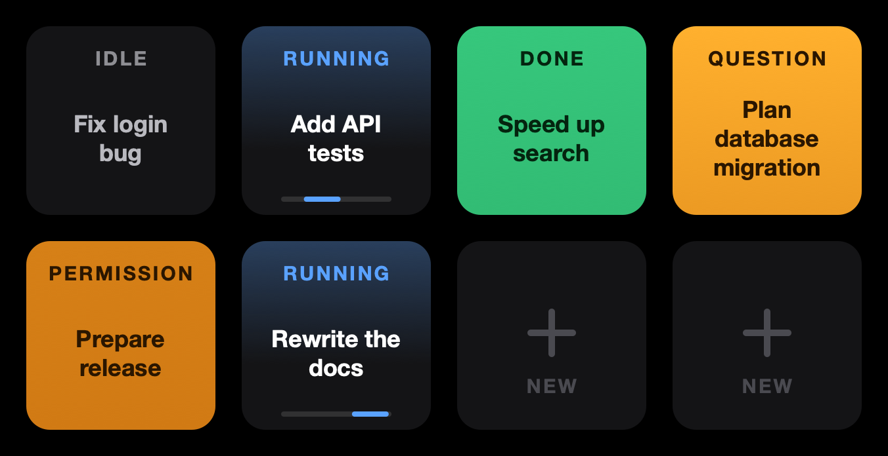

# Claude Sessions for Stream Deck

A Stream Deck plugin that puts the state of your Claude sessions on the keys: running, done, question. Pressing a key opens that session in the Claude desktop app.



> This is an unofficial, community-made plugin. It is not affiliated with, endorsed by or supported by Anthropic or Elgato. "Claude" is a trademark of Anthropic; "Stream Deck" is a trademark of Corsair.

## Features

- **State at a glance:** each key shows one session with its title and state.
- **Jump straight in:** pressing a key opens exactly that session in the Claude desktop app.
- **New session:** pressing a free key starts a new session.
- **No per-key setup:** drag the action onto as many keys as you like; they fill up row by row from the top left, oldest session first.
- **Only what is current:** idle sessions you have already looked at disappear after a configurable time.
- **Language:** the words on the keys are available in English (default) and German.

### States

| Key | State | Meaning |
|---|---|---|
| dark, grey word | Idle | turn finished, result already looked at |
| dark with a blue tint and progress bar | Running | Claude is working, including when only background tasks are still running |
| filled green, still | Done | turn finished, result not looked at yet |
| filled amber, pulsing | Question | Claude asked you a question |
| filled amber, pulsing | Permission | Claude is waiting for a permission |
| dark with a plus | New | free slot |

A filled key means "this concerns you"; a pulsing key means "it is your move".

## Requirements

| | |
|---|---|
| Operating system | **macOS only** (12 or later) |
| Stream Deck app | 7.1 or later |
| Claude | Claude desktop app with sessions in the Code tab |
| To build | Node.js 20 or later |

**Windows and Linux are not supported.** The plugin reads macOS paths of the Claude desktop app and uses the macOS commands `open` and `pgrep`. Elgato also offers no Stream Deck app for Linux.

### Supported Stream Decks

The action is an ordinary key action, so it should work on any Stream Deck with display keys (Neo, MK.2, Mini, XL, +). **It has only been tested on the Stream Deck Neo.**

The Neo's touch points and info bar and the Stream Deck +'s dials and touch strip are not used. The Stream Deck Pedal has no displays, so the plugin is of no use there.

## Install

The plugin is not in the Elgato Marketplace. Download the ready-made build instead:

1. Download `com.alexwiegenstein.claude-sessions.streamDeckPlugin` from the [latest release](https://github.com/alexwiegenstein/claude-sessions-streamdeck/releases/latest).
2. Double-click the file. The Stream Deck app opens and asks whether to install the plugin.
3. Drag the action **Claude Session** from the category **Claude Sessions** onto as many keys as you want sessions visible at once.

A plugin installed this way does not update itself. To update, download the newer release and double-click it again.

### Build from source

If you want to change the plugin, build and link it yourself:

```bash
git clone https://github.com/alexwiegenstein/claude-sessions-streamdeck.git
```

```bash
cd claude-sessions-streamdeck && npm install
```

```bash
npm run build
```

```bash
npm run link
```

Then quit and reopen the Stream Deck app once so it loads the plugin.

### Settings

Click one of the keys in the Stream Deck app to see the settings. Both apply to all keys.

| Setting | Default | What it does |
|---|---|---|
| Language | English | Language of the words on the keys: English or Deutsch. |
| Keep idle for … hours | 8 | How long an idle session you have already looked at stays on its key after its last activity. `0` hides such sessions right away. |

Running sessions, dialogs and unseen results stay visible regardless of the time limit.

## How it works

The plugin does not call any API. It reads files that Claude writes locally anyway, and it sends nothing over the network.

| Source | Provides |
|---|---|
| `~/.claude/sessions/<pid>.json` | per running session: title, status (`busy`, `idle`, `waiting`), what it is waiting for, ID of the desktop session |
| `~/Library/Application Support/Claude/claude-code-sessions/…/<id>.json` | when the session was last in the foreground and last active, whether it is archived |
| `~/.claude/projects/<project>/<sessionId>.jsonl` | the session transcript: start and end of background tasks, a question at the end of a turn |

The state follows from these:

1. If Claude reports `busy`, the session is running. If it reports `waiting`, a question dialog (Question) or a permission request (Permission) is open.
2. If Claude reports `idle`, the transcript decides:
   - If the last turn ended with a question, it is a **Question**. A question is either the one in the "next step" box or a closing sentence that ends in a question mark.
   - If background tasks (shell commands, subagents) were started but not yet reported as finished, the session keeps **Running**.
   - Otherwise it is **Done**, or **Idle** once it has been in the foreground after its last activity.

Sessions are read once per second; the keys are drawn eight times per second (pulse, progress bar). The transcript is read in full only the first time, after that only what was appended.

Pressing a key opens `claude://code/continue?session=<id>`, or `claude://code/new` on a free key.

## Limitations

- **No official interface.** All three sources are internal files of Claude. A Claude update can change their format or location; the keys then show a warning triangle and the error is written to the plugin log. Developed against Claude Desktop 5.11492.5 with Claude Code 2.1.325.
- **Loaded desktop sessions only.** The plugin shows sessions that currently run as a process in the Claude desktop app. It does not show terminal-only CLI sessions, cloud sessions or regular chats.
- **The order shifts.** When an older session ends or drops out of the time limit, the following ones move up one key. There is no fixed assignment of a session to a key.
- **The question mark is a rule of thumb.** If an answer ends with a casual question, the key pulses as a Question too.
- **The time limit also applies to questions.** A session whose question you have seen and left alone for longer than the limit disappears from its key.
- **Done only turns Idle when you reopen the session.** If you are watching a session while it finishes, the key stays green until you switch away and back once.
- **Cancelled subagents.** If a background agent ends without Claude writing a completion notice, the key stays on Running until the session restarts. This does not happen with shell commands, because the plugin additionally checks whether the process still exists.
- **Monitors and workflows** do not count as background work.

## Development

```bash
npm run build
```

```bash
npm run restart
```

`npm run restart` reloads the plugin in the running Stream Deck app and requires its developer mode, which you enable once with `npx streamdeck dev`. `npm run watch` rebuilds on every change, `npm run validate` checks the manifest, and `npm run pack` writes the installable `.streamDeckPlugin` file to `dist/`.

| File | Purpose |
|---|---|
| `src/sessions.ts` | reads the sessions and derives their state |
| `src/transcript.ts` | follows the transcript: background tasks and a question at the end of a turn |
| `src/render.ts` | draws the key images as SVG; colors, design and the words per language |
| `src/session-action.ts` | the Stream Deck action: tick, assignment of keys, key press, settings |
| `com.alexwiegenstein.claude-sessions.sdPlugin/manifest.json` | plugin manifest |
| `com.alexwiegenstein.claude-sessions.sdPlugin/ui/session.html` | settings panel |

The plugin's logs are in `com.alexwiegenstein.claude-sessions.sdPlugin/logs/`.

To add a language, add its words to `WORDS` in `src/render.ts` and an `<option>` to the settings panel.

## License

[MIT](LICENSE)
